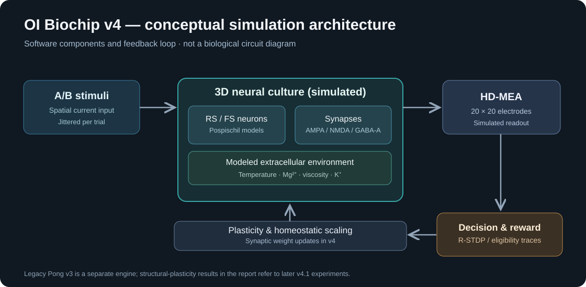
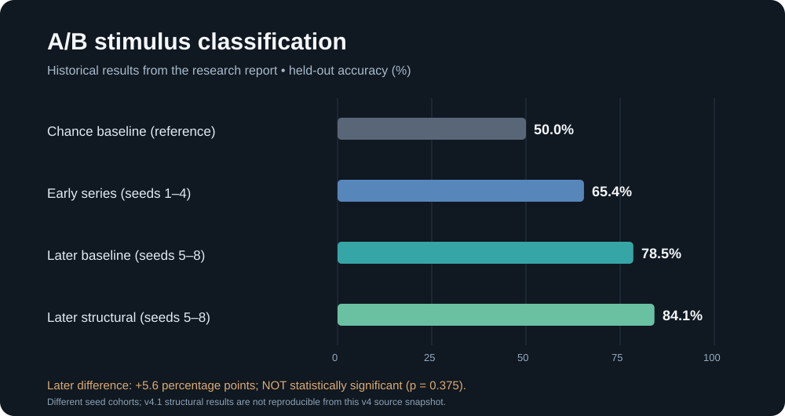

# OI Biochip Simulator v4

[](#quick-start)
[](LICENSE)
[](#research-status)
[](#research-status)
[](https://github.com/nikitashulga1234567-cloud/oi-biochip/actions/workflows/tests.yml)

**An independent computational research prototype exploring organoid intelligence (OI), biologically inspired learning and neural computation.**

This repository contains a Python simulation of a three-dimensional neural culture coupled to a simulated high-density microelectrode array (HD-MEA). **It is not a physical biochip, a living organoid or a biologically validated digital twin.**

**[Research report (PDF, Russian)](docs/OI_biochip.pdf)** · [Source notebook](OI_Pong_3D_Biochip_v4.ipynb) · [Experimental methodology](docs/EXPERIMENTS.md)

## Overview



*Conceptual software architecture. Arrows illustrate the modeled stimulus–response–reward loop, not a measured biological circuit.*

The repository contains two distinct generations of simulation:

| System | Description | Code |
| --- | --- | --- |
| **v4 biophysical model** | 3D RS/FS conductance-based spiking neurons, simulated gel and HD-MEA, reward-modulated synaptic plasticity and A/B stimulus discrimination. | `oipong/bionet.py`, `neuron.py`, `gel.py`, `mea.py`, `plasticity.py`, `task_ab.py` |
| **Legacy v3 Pong** | Separate Pong environment and earlier neural learning engine. | `oipong/game.py`, `network.py`, `learning.py`, `sim.py` |

**The legacy Pong performance must not be attributed to the v4 biophysical network.**

### Features

- **Biophysical neurons:** Pospischil-style regular-spiking (RS) and fast-spiking (FS) conductance models, with a separate Hodgkin–Huxley implementation.
- **Synapses and geometry:** 3D connectivity; AMPA, NMDA and GABA-A synaptic conductances.
- **Modeled extracellular environment:** temperature scaling, magnesium-dependent NMDA block, gel viscosity and extracellular potassium.
- **Electrode interface:** simulated 20 × 20 HD-MEA with stimulation and readout.
- **Learning:** reward-modulated spike-timing-dependent plasticity (R-STDP), eligibility traces, reward critic and homeostatic scaling.
- **Analysis:** A/B stimulus classification, mutual information and transfer-entropy estimates.

These are **computational approximations**, not claims of empirical biological validation.

## Experimental results



*Historical results reported in the accompanying research document — **not rerun for this repository release**. The early 65.4% series (seeds 1–4) differs from the later comparison (seeds 5–8). Values should not be treated as a single controlled comparison.*

| Experiment described in the report | Mean held-out accuracy |
| --- | ---: |
| Initial A/B series, seeds 1–4 | **65.4%** |
| Later baseline without structural plasticity, seeds 5–8 | **78.5%** |
| Later variant with structural plasticity, seeds 5–8 | **84.1%** |

The later comparison shows a **+5.6 percentage-point** observed difference, but **does not establish a statistically significant improvement** (reported `p = 0.375`, limited seed count). The report also discusses stimulus–response mutual information and a non-significant transfer-entropy result (`p = 0.94`). These figures are not evidence of organoid consciousness or general intelligence.

**Version caveat:** the report discusses **v4.1 structural-plasticity experiments**, whereas this repository's provided code is a **v4 snapshot** without the later structural-update implementation. Therefore the v4.1 results cannot be reproduced from this exact source tree. See [experiment notes](docs/EXPERIMENTS.md) for details.

## Quick start

**Recommended:** Python 3.10+ and a virtual environment.

```bash
git clone https://github.com/nikitashulga1234567-cloud/oi-biochip.git
cd oi-biochip
python -m venv .venv
```

Activate it with `source .venv/bin/activate` on Linux/macOS or `.venv\Scripts\activate` in Windows PowerShell, then:

```bash
python -m pip install -r requirements.txt
python -m unittest discover -s tests -v
```

Run an optional single-neuron f–I check:

```bash
python oi_v4_checks.py fi
```

Run an A/B experiment (can be **computationally expensive**):

```bash
python oi_v4_checks.py ab --seeds 1 --n 1000 --train 900 --eval 200 --procs 1
```

Experiment outputs are saved in `out/`. The original [Jupyter notebook](OI_Pong_3D_Biochip_v4.ipynb) can also be opened in Google Colab. Its optional Google Sheets integration requests authentication and is **not required** for simulation.

## Repository map

```text
oipong/                       Python simulator modules
tests/test_smoke.py            Lightweight validation tests
oi_v4_checks.py                Experiment and visualization entry point
oi_engine.py                   Compatibility entry point
OI_Pong_3D_Biochip_v4.ipynb    Original Colab notebook
docs/OI_biochip.pdf            Research report (Russian)
docs/EXPERIMENTS.md            Evidence, comparisons and limitations
assets/                       Documentation-only diagrams
.github/workflows/tests.yml    Automated smoke tests
```

## Research status

**Independent research prototype — development currently paused.** This archive preserves an experimental software model and its accompanying research report. The code is shared as-is, without claims of clinical relevance or biological validation.

Key limitations:

1. **Reproducibility:** reported later v4.1 structural-plasticity results are not reproducible from this v4 code snapshot.
2. **Statistical power:** the observed structural-plasticity effect is not statistically conclusive.
3. **Scaling:** dense `N × N` arrays impose substantial memory costs; sparse representations would be needed for much larger networks.
4. **Biological fidelity:** model assumptions require quantitative comparison with real electrophysiological data.
5. **Task separation:** the Pong implementation and the v4 A/B experiment use different engines.

This repository is provided for **study, reproduction of available v4 functionality and future experimentation**, not as a finished biological technology.

## References

- Pospischil et al. (2008), *Minimal Hodgkin–Huxley type models for different classes of cortical and thalamic neurons*. https://doi.org/10.1007/s00422-008-0263-8
- Hodgkin & Huxley (1952), *A quantitative description of membrane current and its application to conduction and excitation in nerve*. https://doi.org/10.1113/jphysiol.1952.sp004764
- Izhikevich (2007), *Solving the distal reward problem through linkage of STDP and dopamine*.
- Full bibliography and study details: [research report](docs/OI_biochip.pdf).

## License

Source code is distributed under the [MIT License](LICENSE). The author's research document and any third-party material may have separate rights; check before reusing them.
